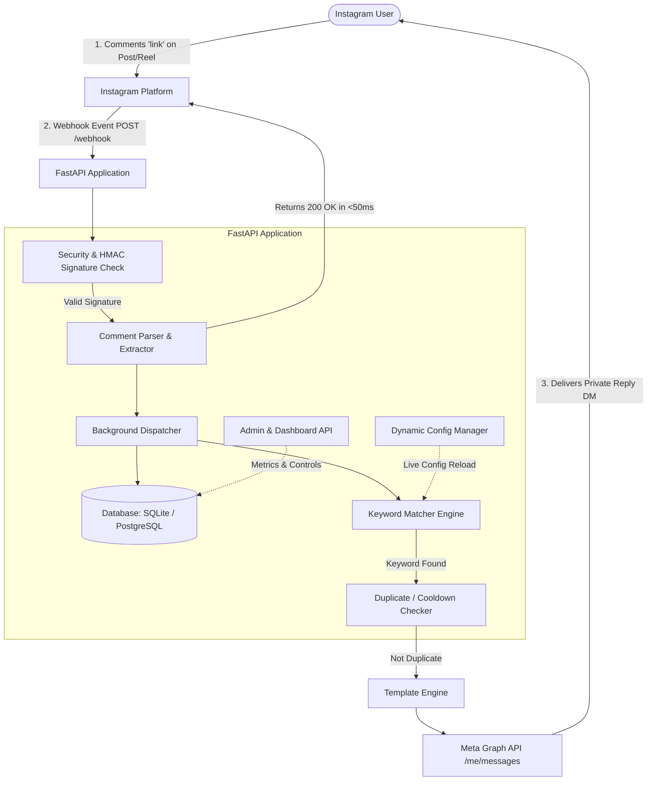

# Instagram Comment → Auto DM Automation

A modular, production-ready automation service built with **FastAPI**, **SQLAlchemy**, and the official **Meta Instagram Graph API / Messenger Platform**. It automatically monitors comments on Instagram Posts and Reels, detects customizable keywords, and delivers personalized Direct Messages (Private Replies) containing resources and links to commenters.

---

## 📑 Table of Contents

1. [Meta Official API Support & Policy Compliance](#-meta-official-api-support--policy-compliance)
2. [Architecture Diagram](#-architecture-diagram)
3. [Key Features](#-key-features)
4. [Prerequisites & Meta Requirements](#-prerequisites--meta-requirements)
5. [Local Setup Guide](#-local-setup-guide)
6. [Configuration Reference (`config.json` & `.env`)](#-configuration-reference)
7. [Meta App Setup & Webhook Configuration Guide](#-meta-app-setup--webhook-configuration-guide)
8. [API Documentation & Examples](#-api-documentation--examples)
9. [Deployment Guides](#-deployment-guides)
   - [Docker & Docker Compose](#1-docker--docker-compose)
   - [Railway](#2-railway)
   - [Render](#3-render)
   - [AWS EC2 / Ubuntu VPS](#4-aws-ec2--ubuntu-vps)
   - [DigitalOcean](#5-digitalocean)
10. [Troubleshooting & Common Issues](#-troubleshooting--common-issues)
11. [Testing & Verification](#-testing--verification)

---

## ⚖️ Meta Official API Support & Policy Compliance

This automation strictly adheres to Meta's Official Developer Policies and relies exclusively on authorized Meta endpoints. **No scraping, browser automation (Puppeteer/Selenium), or reverse-engineered APIs are used.**

### 1. Supported Mechanism: Instagram "Private Replies"
Meta officially provides the ability to send a direct message in response to an Instagram media comment via the Messenger API for Instagram endpoint:
`POST https://graph.facebook.com/v21.0/me/messages` (or `/{INSTAGRAM_ACCOUNT_ID}/messages`) with the payload:
```json
{
  "recipient": {
    "comment_id": "<COMMENT_ID>"
  },
  "message": {
    "text": "Your message here..."
  }
}
```

### 2. Official Limitations & Rules
- **Single-Message Window**: Meta allows **exactly one proactive message** to be sent in response to a user's comment (`recipient.comment_id`). The standard 24-hour messaging window does **not** open until the user actually sends a reply back into the DM thread.
- **7-Day Expiration**: A Private Reply to a comment can only be dispatched within **7 days** of the comment being posted.
- **Cooldown & Spam Prevention**: Repeatedly spamming users who comment violates Meta's Community Guidelines. This project includes a configurable duplicate cooldown filter (`reply_once_days: 7`).
- **Account Type**: Only **Instagram Professional Accounts** (Business or Creator) connected to a Facebook Page are supported. Personal accounts cannot receive Webhooks or send API messages.
- **Inbox Permission**: The setting **"Allow Access to Messages"** must be toggled **ON** in the Instagram mobile app under *Settings > Privacy > Messages > Connected Tools*.

### 3. Required Meta Permissions
| Permission | Purpose |
|---|---|
| `instagram_basic` | Access public profile info, Instagram account ID, and media list. |
| `instagram_manage_comments` | Receive real-time comment webhooks, read comment text, and reply. |
| `instagram_manage_messages` | Send Private Reply DMs and access the Instagram Messaging API. |
| `pages_manage_metadata` | Subscribe Facebook Pages and linked Instagram accounts to Webhooks. |
| `pages_read_engagement` | Read engagement data on linked Facebook Pages. |

### 4. App Review Requirements
- **Development Mode**: The app works out-of-the-box for users who hold roles on the Meta App (Admins, Developers, Testers) with their linked test accounts.
- **Production Mode**: To interact with the general public, Meta requires **Business Verification** and passing **App Review** for `instagram_manage_messages` and `instagram_manage_comments`.

---

## 🏛 Architecture Diagram



---

## ⚡ Key Features

- **Real-Time Webhook Processing**: Validates Meta challenge (`GET /webhook`) and receives comments on Posts & Reels (`POST /webhook`).
- **Sub-Second Webhook Response**: Uses asynchronous FastAPI background tasks to return `200 OK` in `<50ms` (well below Meta's 2-second timeout).
- **HMAC SHA-256 Signature Verification**: Cryptographically validates every incoming webhook request using `META_APP_SECRET`.
- **Configurable Keyword Matching**:
  - `partial`: Substring matching (`"link"` matches `"please send link"`).
  - `exact`: Word-boundary matching (`"link"` matches `"send link"`, but ignores `"blink"`).
  - `regex`: Custom regex patterns (e.g. `r"batch\s*[0-9]{4}"`).
  - Configurable case sensitivity.
- **Smart Deduplication & Cooldown**: Configurable cooldown (default: 7 days) prevents spamming the same user for multiple comments. Supports global or media-specific cooldowns.
- **Live Admin Controls & Hot-Reload**: Update keywords, cooldowns, templates, or toggle automation `on/off` dynamically via REST API without server restart.
- **Built-in Metrics Dashboard**: Real-time web UI (`/dashboard`) displaying total comments, matches, sent DMs, duplicates, success rate, and recent activity logs.
- **Exponential Backoff & Transient Retry**: Automatically retries transient Meta errors (rate limits, 5xx, timeouts) up to 3 times while failing fast on permanent errors (401, deleted comments).
- **Security & Privacy**: Automatically redacts tokens and app secrets from logs.

---

## 📋 Prerequisites & Meta Requirements

1. **Instagram Account**: Must be an **Instagram Business** or **Creator** account.
2. **Facebook Page**: Must be connected to your Instagram account.
3. **Meta Developer App**:
   - Create a **Business App** at [developers.facebook.com](https://developers.facebook.com).
   - Add the **Instagram Graph API** and **Messenger** products.
4. **Python**: Version `3.10+` (Python 3.12 recommended) or **Docker**.

---

## 🛠 Local Setup Guide

### 1. Clone & Enter Project
```bash
git clone <your-repo-url>
cd Automation-replies
```

### 2. Create Virtual Environment
```bash
# On Linux/macOS:
python3 -m venv .venv
source .venv/bin/activate

# On Windows (PowerShell):
python -m venv .venv
.\.venv\Scripts\Activate.ps1
```

### 3. Install Dependencies
```bash
pip install -r requirements-dev.txt
```

### 4. Configure Environment
Copy `.env.example` to `.env` and fill in your values:
```bash
cp .env.example .env
```

| Key | Description | Example |
|---|---|---|
| `META_APP_ID` | Your Meta Developer App ID | `123456789012345` |
| `META_APP_SECRET` | App Secret from App Settings > Basic | `0123456789abcdef...` |
| `VERIFY_TOKEN` | A random secret string you choose for webhook verification | `my_super_secret_verify_token_123` |
| `PAGE_ACCESS_TOKEN` | Long-lived Page Access Token | `EAA...` |
| `INSTAGRAM_ACCOUNT_ID` | Instagram Professional Account ID | `17841400000000000` |
| `DATABASE_URL` | Database connection string | `sqlite:///./instagram_automation.db` |
| `PORT` | Local server port | `8000` |
| `ADMIN_API_KEY` | Optional key to protect admin endpoints | `secret_admin_key_123` |

### 5. Run the Application
```bash
uvicorn app.main:app --host 0.0.0.0 --port 8000 --reload
```

Visit the services:
- **Interactive Dashboard**: [http://localhost:8000/dashboard](http://localhost:8000/dashboard)
- **API Swagger Documentation**: [http://localhost:8000/docs](http://localhost:8000/docs)
- **Health Check**: [http://localhost:8000/health](http://localhost:8000/health)

---

## ⚙️ Configuration Reference

### `config.json`
This file is hot-reloaded dynamically on edits or via the admin API:

```json
{
  "enabled": true,
  "match_mode": "partial",
  "case_sensitive": false,
  "keywords": [
    "link",
    "guide",
    "pdf",
    "roadmap",
    "job",
    "placement",
    "send",
    "help",
    "info"
  ],
  "reply_once_days": 7,
  "media_id_cooldown_only": false,
  "message_template": "Hi {username} 👋\n\nThanks for commenting! Here are the resources you requested:\n\n📌 Infosys Prep Kit:\nhttps://example.com/resources/infosys\n\n📌 TCS NQT Complete Guide:\nhttps://example.com/resources/tcs-nqt\n\n📌 CodeVita Roadmap:\nhttps://example.com/resources/codevita\n\nBest of luck! ❤️",
  "rate_limit_per_minute": 60,
  "max_retries": 3,
  "retry_backoff_factor": 2.0
}
```

#### Template Placeholders
- `{username}`: The Instagram username of the commenter (or "friend" if unavailable).
- `{keyword}`: The specific keyword that was matched.
- `{media_id}`: The ID of the post/reel commented on.

---

## 🔗 Meta App Setup & Webhook Configuration Guide

### Step 1: Instagram Account Settings
1. Open Instagram App on mobile.
2. Go to **Settings & Privacy** > **Messages and story replies** > **Message controls**.
3. Under **Connected Tools**, toggle **Allow Access to Messages** to **ON**.

### Step 2: Facebook Page Connection
1. Link your Instagram Professional account to a Facebook Page in Meta Business Suite.

### Step 3: Meta Developer App Creation
1. Go to [developers.facebook.com](https://developers.facebook.com) > **My Apps** > **Create App**.
2. Select **Other** > App Type: **Business**.
3. Under Add Products, add:
   - **Instagram Graph API**
   - **Messenger**

### Step 4: Expose Local Webhook (for testing)
If testing locally, use `ngrok` or `cloudflared`:
```bash
ngrok http 8000
```
Copy the generated HTTPS URL: `https://your-domain.ngrok-free.app`.

### Step 5: Subscribe to Webhooks
1. In Meta Developer Dashboard, navigate to **Webhooks** in the sidebar.
2. Select **Instagram** from the dropdown.
3. Click **Subscribe to this object**.
   - **Callback URL**: `https://your-domain.ngrok-free.app/webhook`
   - **Verify Token**: Must match `VERIFY_TOKEN` in your `.env`.
4. Click **Verify and Save**.
5. In the table of Webhook fields, locate **`comments`** and click **Subscribe**.

---

## 📡 API Documentation & Examples

### 1. Webhook Verification (`GET /webhook`)
Meta sends this upon entering the Webhook URL:
```bash
curl -X GET "http://localhost:8000/webhook?hub.mode=subscribe&hub.challenge=1158201244&hub.verify_token=your_verify_token"
```
**Response (200 OK, text/plain):**
```
1158201244
```

### 2. Incoming Comment Webhook (`POST /webhook`)
Meta delivers comment events formatted as:
```bash
curl -X POST "http://localhost:8000/webhook" \
  -H "Content-Type: application/json" \
  -H "X-Hub-Signature-256: sha256=<HMAC_HEX_DIGEST>" \
  -d '{
    "object": "instagram",
    "entry": [
      {
        "id": "17841400000000001",
        "time": 1730001122,
        "changes": [
          {
            "field": "comments",
            "value": {
              "id": "17999888777666",
              "text": "Please send me the guide!",
              "from": {
                "id": "17841499999999",
                "username": "coder_jane"
              },
              "media": {
                "id": "18000111222333",
                "media_product_type": "FEED"
              }
            }
          }
        ]
      }
    ]
  }'
```
**Response (200 OK, application/json):**
```json
{
  "status": "ok",
  "enqueued_events": 1
}
```

### 3. Fetch Dashboard Stats (`GET /api/v1/stats`)
```bash
curl -X GET "http://localhost:8000/api/v1/stats"
```
**Response (200 OK):**
```json
{
  "total_comments": 42,
  "matched_comments": 38,
  "dms_sent": 35,
  "dms_failed": 0,
  "dms_skipped_duplicate": 3,
  "dms_skipped_disabled": 0,
  "success_rate_percent": 100.0,
  "automation_enabled": true,
  "active_keywords_count": 9,
  "recent_logs": []
}
```

### 4. Admin Dynamic Config Update (`POST /api/v1/settings`)
```bash
curl -X POST "http://localhost:8000/api/v1/settings" \
  -H "Content-Type: application/json" \
  -H "X-API-Key: change_this_to_a_secure_random_key" \
  -d '{
    "reply_once_days": 14,
    "keywords": ["link", "guide", "pdf", "placement"]
  }'
```

---

## 🚀 Deployment Guides

### 1. Docker & Docker Compose
The fastest, production-ready way to run with PostgreSQL:

```bash
# 1. Edit .env with your Meta credentials & secure passwords
cp .env.example .env

# 2. Build and launch with Docker Compose
docker compose up -d --build

# 3. Check logs
docker compose logs -f app
```

### 2. Railway
1. Push your repository to GitHub.
2. In Railway, click **New Project** > **Deploy from GitHub repo**.
3. Add a **PostgreSQL** database service in Railway.
4. Set Railway Environment Variables matching `.env` (set `DATABASE_URL` to Railway's Postgres URL).
5. Railway automatically detects the `Dockerfile` and deploys.

### 3. Render
1. Create a **Web Service** on Render connected to your repository.
2. Set Environment to **Docker**.
3. Create a **Render PostgreSQL** database and link `DATABASE_URL`.
4. Add environment variables (`META_APP_SECRET`, `PAGE_ACCESS_TOKEN`, etc.).
5. Set Health Check path to `/health`.

### 4. AWS EC2 / Ubuntu VPS
```bash
# Update and install Docker + Git
sudo apt-get update && sudo apt-get install -y git docker.io docker-compose-v2

# Clone repository
git clone <your-repo-url> /opt/instagram-automation
cd /opt/instagram-automation

# Configure environment
cp .env.example .env
nano .env

# Run containers in background
sudo docker compose -f docker-compose.yml up -d

# (Optional) Point Nginx with Let's Encrypt SSL to port 8000
```

### 5. DigitalOcean
Deploy either using **DigitalOcean Droplets** (via Docker Compose above) or **DigitalOcean App Platform** (pointing directly to the Dockerfile).

---

## 🔍 Troubleshooting & Common Issues

| Issue / Error | Root Cause | Solution |
|---|---|---|
| **403 Verification Failed on Webhook** | `hub.verify_token` does not match `VERIFY_TOKEN` in `.env`. | Verify that the string entered in the Meta App Webhooks page matches `VERIFY_TOKEN` exactly. |
| **401 Invalid Signature** | `X-Hub-Signature-256` mismatch. | Ensure `META_APP_SECRET` in `.env` matches the App Secret in App Settings > Basic. |
| **Meta Error 10 / 200 (Permission Denied)** | Missing permissions or account not linked. | Ensure `instagram_manage_messages` is granted to the token and the IG account is Business/Creator. |
| **Meta Error 100 (Subcode 33 / Invalid Comment)** | Comment was deleted by the user or expired (>7 days). | The system flags this as non-retryable and logs it gracefully without spamming retries. |
| **Messages Not Arriving** | "Allow Access to Messages" is OFF. | Toggle ON in Instagram Mobile App: *Settings > Privacy > Messages > Connected Tools*. |
| **Token Expired (Code 190)** | Short-lived token expired. | Generate a long-lived Page Access Token or call `/oauth/access_token` via `MetaClient.refresh_token()`. |

---

## 🧪 Testing & Verification

Run the test suite with coverage:
```bash
pytest -v
```

All 35 unit and integration tests cover:
- HMAC-SHA256 signature verification & tamper rejection
- Webhook GET verification challenge
- Keyword detection (partial, exact, regex, case insensitivity)
- 7-day duplicate cooldown rules
- Transactional comment processing & idempotency
- Admin API live updates and master toggle
- Mocked Meta Graph API dispatch and error classification
